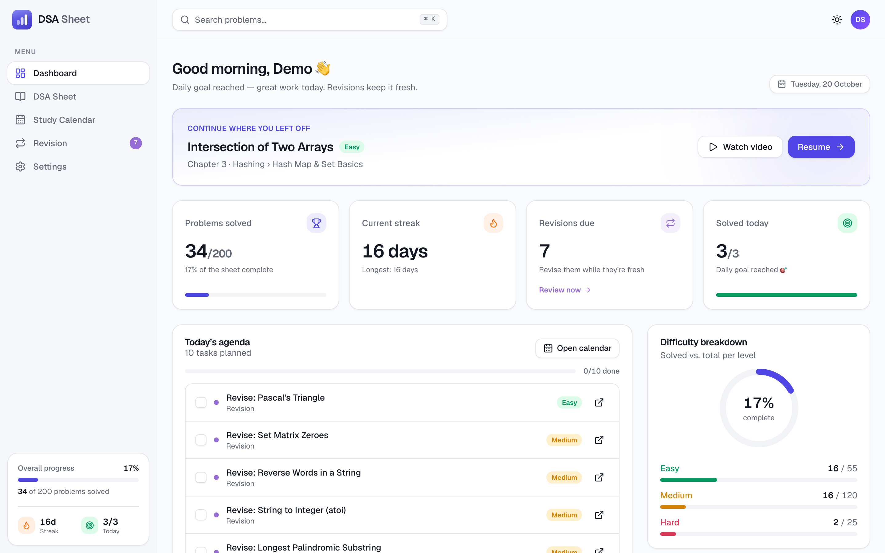
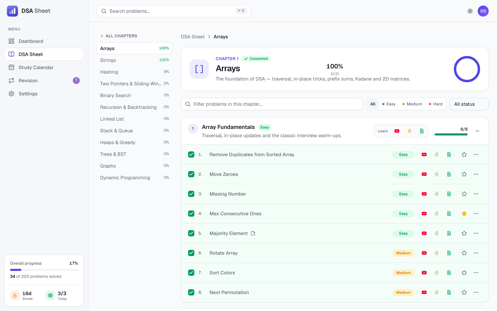
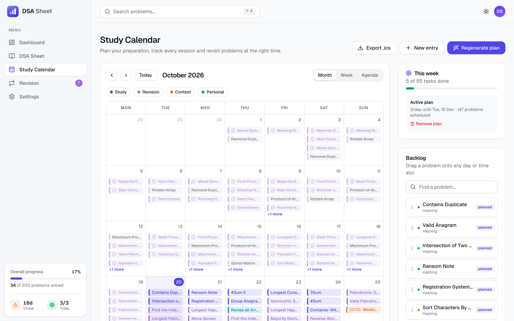
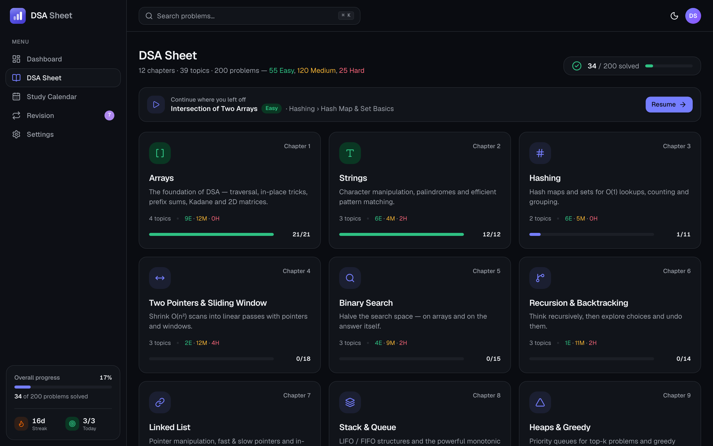
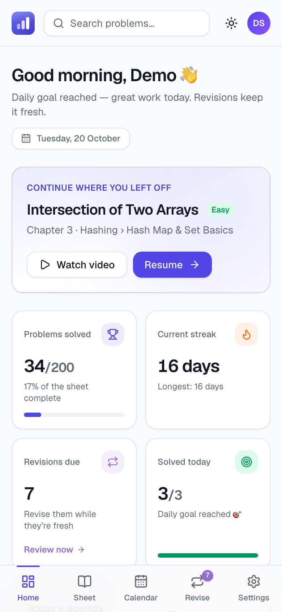
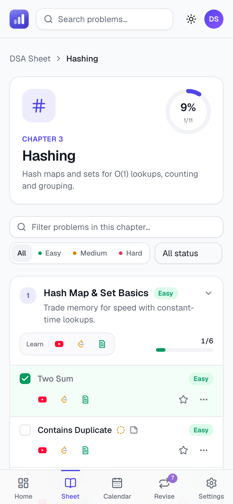

# DSA Sheet: plan, track and master Data Structures & Algorithms

A full-stack **MERN + TypeScript** web app that gives students a structured DSA sheet:

- **12 chapters → 39 topics → 200 hand-picked problems**, each with a video, a practice link and an article
- progress that persists the moment a box is ticked
- a **standalone study calendar** that plans, tracks and schedules spaced-repetition revisions

> **Live demo:** **https://dd2dekdh8uhzz.cloudfront.net** (AWS · Sydney `ap-southeast-2` · cost-optimised [lite profile](docs/DEPLOYMENT.md#two-deployment-profiles)). Click **“Try the live demo”**; no sign-up needed.
> **API docs:** [/api/docs](https://dd2dekdh8uhzz.cloudfront.net/api/docs) · **Demo login:** `demo@dsasheet.dev` / `Demo@1234`

| Dashboard                                    | Chapter → Topics → Problems                  |
| -------------------------------------------- | -------------------------------------------- |
|  |  |
| **Study calendar**                           | **Dark mode**                                |
|    |      |

<p align="center">
  
  
</p>

---

## Assessment checklist

| #      | Requirement (from the brief)                                                          | Implementation                                                                                                                                                                                                                                                                                                                                                                                                                        |
| ------ | ------------------------------------------------------------------------------------- | ------------------------------------------------------------------------------------------------------------------------------------------------------------------------------------------------------------------------------------------------------------------------------------------------------------------------------------------------------------------------------------------------------------------------------------- |
| 1      | **Login page**, secure authentication                                                 | Register / login / one-click demo. bcrypt (cost 12). 15-min JWT access token held **only in memory**. Rotating refresh token in an **httpOnly, Secure, SameSite=Strict** cookie, stored server-side as a SHA-256 hash (revocable; "log out everywhere"). Rate-limited, Zod-validated                                                                                                                                                  |
| 2      | **Structured sheet**, Chapters / Topics / Problems                                    | Chapter grid → chapter page with collapsible topics → problem rows. Chapter rail, breadcrumbs, prev/next chapter, **⌘K search** across all 200 problems                                                                                                                                                                                                                                                                               |
| 3      | **Problem breakdown**                                                                 | Every chapter has 2–4 sub-topics, each with 3–8 problems ordered easy → hard                                                                                                                                                                                                                                                                                                                                                          |
| 4      | **Resources** for each topic **and** problem: YouTube, LeetCode / Codeforces, article | 717 links. LeetCode titles and difficulty come from LeetCode's API; 7 Codeforces problems come from the Codeforces API; videos come mostly from take U forward and NeetCode and are matched to the problem title; articles are from GeeksforGeeks / cp-algorithms / the doocs wiki. All are **verified by an automated validator** (weekly in CI)                                                                                     |
| 5      | **Difficulty** on each problem **and** topic                                          | Colour-coded Easy / Medium / Hard badges, using official platform difficulty; difficulty filters                                                                                                                                                                                                                                                                                                                                      |
| 6      | **Progress checkbox**: persists, resume on next login                                 | Optimistic checkbox → idempotent `PUT /progress/:id`. Topic, chapter and overall progress update instantly. **"Continue where you left off"** deep-links to and highlights the exact problem. Also: stars, notes, "attempted" state, streaks, heatmap. Every solve gets feedback with **Undo**; confetti marks the first problem, a finished topic, the daily goal and milestones, and a celebration dialog marks a completed chapter |
| 7      | **Calendar**: dedicated page to plan, track and revisit                               | Month / week / agenda views. **Auto study-plan wizard** with a live capacity check. **Drag-and-drop** backlog and rescheduling. Done / missed / overdue states with **rollover**. **Spaced-repetition revisions** (+1/3/7/21 days) generated automatically. Weekly completion tracking. **`.ics` export**                                                                                                                             |
| HLD    | Architecture, request flow, auth, progress data flow, scalability                     | [`docs/SYSTEM_DESIGN.md`](docs/SYSTEM_DESIGN.md)                                                                                                                                                                                                                                                                                                                                                                                      |
| LLD    | Users, Topics, Problems, User Progress, relationships, indexing                       | [`docs/DATABASE_SCHEMA.md`](docs/DATABASE_SCHEMA.md)                                                                                                                                                                                                                                                                                                                                                                                  |
| Bonus  | API design · scalability improvements · trade-offs                                    | [`docs/API.md`](docs/API.md) · [System Design §7, §9, §10](docs/SYSTEM_DESIGN.md) · [ADRs](docs/adr) · [load test](loadtest/RESULTS.md)                                                                                                                                                                                                                                                                                               |
| Deploy | AWS                                                                                   | CloudFront + S3 + ALB + ECS Fargate + Atlas, as code: [`docs/DEPLOYMENT.md`](docs/DEPLOYMENT.md)                                                                                                                                                                                                                                                                                                                                      |
| Video  | 2–5 min walkthrough                                                                   | Script: [`docs/DEMO_VIDEO_SCRIPT.md`](docs/DEMO_VIDEO_SCRIPT.md)                                                                                                                                                                                                                                                                                                                                                                      |

---

## Tech stack

| Layer        | Choices                                                                                                                                                                                     |
| ------------ | ------------------------------------------------------------------------------------------------------------------------------------------------------------------------------------------- |
| **Frontend** | React 19 · Vite · TypeScript · Tailwind CSS v4 · **shadcn/ui** (Radix primitives) · TanStack Query · Zustand · React Router · React Hook Form + Zod · FullCalendar · cmdk · Sonner · Lucide |
| **Backend**  | Node 22 · **Express 5** · TypeScript · **Mongoose 9** · Zod · JWT · bcrypt · Helmet · express-rate-limit · Pino · Swagger UI (OpenAPI 3.1 generated from Zod)                               |
| **Database** | **MongoDB 8** (Atlas in production)                                                                                                                                                         |
| **Infra**    | Docker · AWS CloudFront, S3, ALB, ECS Fargate, ECR, SSM, CloudWatch · CloudFormation · GitHub Actions                                                                                       |
| **Quality**  | Vitest + Supertest + mongodb-memory-server (26 API tests) · Playwright E2E (desktop + mobile) · k6 load tests · ESLint · Prettier · cfn-lint                                                |

## Architecture at a glance

```
Browser ──► CloudFront ──┬── /*      ──► S3 (React SPA)
                         └── /api/*  ──► ALB ──► ECS Fargate (Express API, 2–6 tasks) ──► MongoDB Atlas
```

- A **stateless API** scales horizontally.
- The **public sheet is cached at the edge**; per-user data is never cached.
- Every per-user query hits a **`userId`-prefixed index**.
- **Measured** with 500 concurrent students: p95 **28 ms** and **0 errors**. One API process sustains about 600 req/s.

Full details, diagrams and capacity maths: [`docs/SYSTEM_DESIGN.md`](docs/SYSTEM_DESIGN.md).

---

## Quick start (local)

**Requirements:** Node.js 20+ and Docker (for MongoDB).

```bash
# 1. Install
npm install

# 2. Start MongoDB
docker run -d --name dsa-mongo -p 27017:27017 -v dsa-mongo-data:/data/db mongo:8.2

# 3. Configure the API
cp server/.env.example server/.env        # then set JWT_ACCESS_SECRET to a long random string

# 4. Load content + demo account (idempotent; safe to re-run)
npm run seed

# 5. Run API (http://localhost:4000) and web app (http://localhost:5173)
npm run dev
```

Alternatively, run the whole production-like stack in Docker: `docker compose up --build`, then `docker compose run --rm api node server/dist/seed/seed.js`, and open http://localhost:8080.

### Scripts

| Command                                                 | What it does                                                                                   |
| ------------------------------------------------------- | ---------------------------------------------------------------------------------------------- |
| `npm run dev`                                           | API (tsx watch) + web (Vite, proxies `/api`)                                                   |
| `npm run seed`                                          | Validate content files with Zod and upsert chapters/topics/problems; recreate the demo student |
| `npm test`                                              | 26 API integration tests on an in-memory MongoDB                                               |
| `npm run test:e2e`                                      | Playwright: register → tick → logout → login → still ticked, on desktop and mobile             |
| `npm run typecheck` · `npm run lint` · `npm run format` | Static checks                                                                                  |
| `npm run validate:links`                                | Check all 717 resource links against the live platforms                                        |
| `npm run build`                                         | Production builds (server bundle + static client)                                              |

---

## Project structure

```
├── shared/                 Zod schemas, DTO types, constants: the client ↔ server contract
├── server/
│   ├── src/
│   │   ├── config/         env validation (fail fast), DB connection
│   │   ├── middleware/     auth, validation, rate limits, timezone, errors
│   │   ├── models/         Mongoose schemas + indexes (8 collections)
│   │   ├── modules/        auth · sheet · progress · calendar · users · health
│   │   │                   (routes → controller → service)
│   │   ├── docs/           OpenAPI document
│   │   └── seed/           content data (12 JSON files), seed, link validator
│   ├── scripts/            content resolver (spec → verified data) + review report
│   └── tests/              integration tests
├── client/src/
│   ├── components/ui/      design-system primitives (shadcn/ui)
│   ├── components/layout/  app shell, sidebar, ⌘K command palette
│   └── features/           auth · sheet · dashboard · calendar · revision · settings · landing
├── e2e/                    Playwright specs
├── loadtest/               k6 scenarios + results
├── infra/                  Dockerfiles, nginx, AWS CloudFormation + deploy script
├── docs/                   system design, schema, API, deployment, ADRs, video script
└── .github/workflows/      CI · deploy (OIDC) · weekly link check
```

## How the content was built

The sheet content is generated by code, then reviewed:

1. [`server/scripts/content-spec.ts`](server/scripts/content-spec.ts) defines the curriculum: chapters, topics and problem references (`lc:two-sum`, `cf:466C`).
2. [`resolve-content.ts`](server/scripts/resolve-content.ts) expands it:
   - official titles and difficulty from LeetCode's GraphQL API and the Codeforces API;
   - a matching explanation video from preferred DSA channels, with the title checked against the problem and existence confirmed via oEmbed;
   - a live theory article for each topic and problem.
3. It writes a human-readable [review report](server/scripts/content-report.md). Mismatches were fixed with explicit rules in the spec.
4. [`validate-links.ts`](server/src/seed/validate-links.ts) re-checks every link weekly in CI, so dead links are caught.

## Deployment

One command, once AWS credentials and an Atlas cluster are set up:

```bash
./infra/aws/deploy.sh secrets   # one-time: Atlas URI + generated JWT secret → SSM
./infra/aws/deploy.sh           # build/push image, CloudFormation, upload SPA, invalidate CDN
./infra/aws/deploy.sh seed      # one-time: load content into Atlas
```

See [`docs/DEPLOYMENT.md`](docs/DEPLOYMENT.md) for the resources created, CI/CD, cost and hardening.

## Experience details

- **Onboarding:** new students see a three-step "Getting started" checklist (first problem → study plan → 3-day streak) and a "Start here" pointer.
- **Feedback on every action:** toasts with Undo for solves, notes, scheduling and calendar tasks, plus celebrations for milestones and an "everything done today" moment. Confetti respects the OS _reduce motion_ setting.
- **Daily goal:** "Solved today 2/3" on the dashboard and in the sidebar, matching the goal set in Settings.
- **Mobile:** a bottom tab bar with a due-revisions badge, a compact agenda view and responsive layouts tested at 360 / 390 / 768 px.
- **Accessibility:** keyboard-navigable Radix primitives, a skip-to-content link, labelled icon buttons, `aria-pressed` toggles and visible focus rings.
- **Light and dark themes everywhere,** including the auth screens, toasts and calendar.

## Security highlights

- Passwords: bcrypt hashing.
- Tokens: no tokens in `localStorage`; httpOnly, path-scoped refresh cookie with rotation.
- Login: constant-time responses, rate limits.
- Input: Zod validation on every input.
- Access: every query is scoped to the authenticated user; other users' resources return 404.
- Headers and logs: Helmet CSP / HSTS; logs redact credentials.
- Secrets: kept in SSM, never in the image or the repository.
- Network: the ALB is reachable only through CloudFront; the S3 bucket is private.
