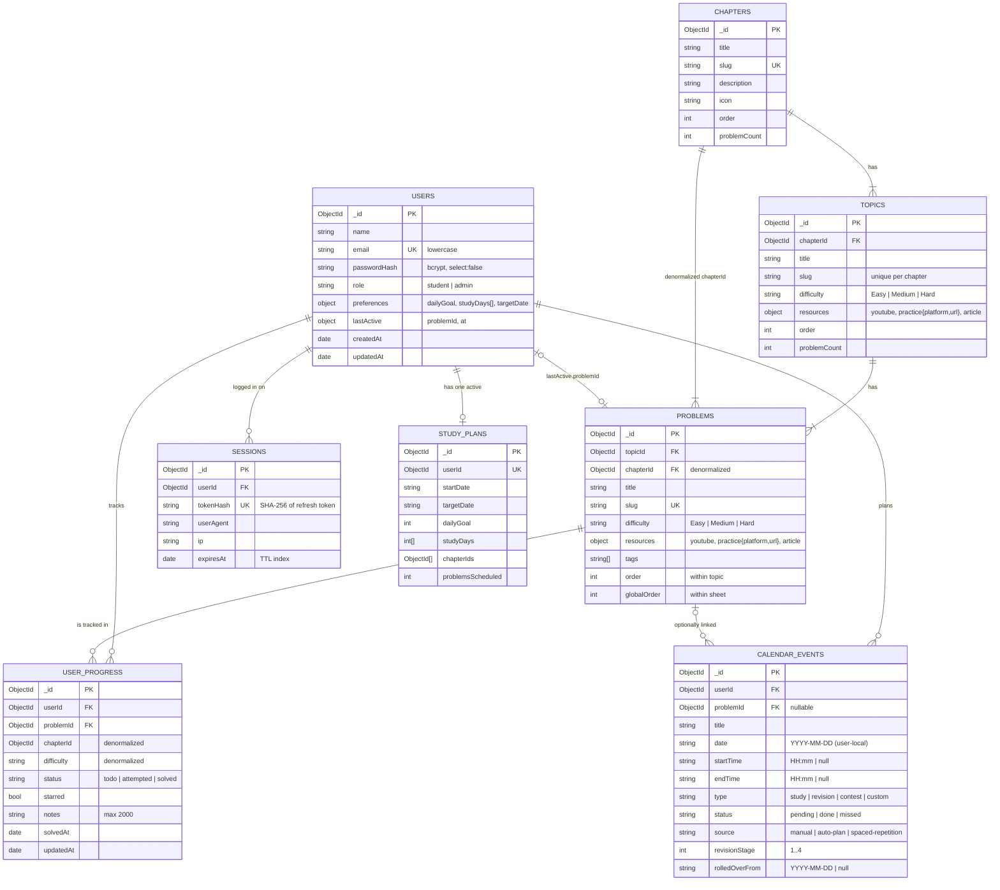

# Database Schema (LLD)

**Database:** MongoDB 8 (MongoDB Atlas on AWS, same Region as the API — `ap-southeast-2` Sydney for the live demo, `ap-south-1` Mumbai in the production design) · **ODM:** Mongoose 9 · **Design target:** 10,000–50,000 active students

The assessment asks for **Users, Topics, Problems and User Progress**. All four exist with exactly those names. Four more collections support the hierarchy, secure sessions and the calendar. Each one is justified below.

| Collection       | Required by the PDF | Purpose                                                                        |
| ---------------- | ------------------- | ------------------------------------------------------------------------------ |
| `users`          | ✅ Users            | Student accounts, study preferences, "resume where you left off" pointer       |
| `topics`         | ✅ Topics           | Sub-topics of a chapter, each with its own difficulty and learning resources   |
| `problems`       | ✅ Problems         | Individual problems with difficulty and YouTube / practice / article links     |
| `userProgress`   | ✅ User Progress    | One row per (student, problem): checkbox state, star, notes, solve time        |
| `chapters`       | Hierarchy (§2)      | Top level of _Chapter → Topic → Problem_                                       |
| `sessions`       | Secure login (§1)   | Hashed refresh tokens, one per logged-in device; enables logout and revocation |
| `calendarEvents` | Calendar (§7)       | Study tasks, spaced-repetition revisions, contests and personal entries        |
| `studyPlans`     | Calendar (§7)       | Settings of the auto-generated study plan                                      |

---

## 1. Entity-relationship diagram



### Relationship summary

| Relationship              | Cardinality | How it is stored                                | Why                                                              |
| ------------------------- | ----------- | ----------------------------------------------- | ---------------------------------------------------------------- |
| Chapter → Topic           | 1 : N       | `topics.chapterId`                              | Topics are queried as a set per chapter and edited independently |
| Topic → Problem           | 1 : N       | `problems.topicId` (+ denormalized `chapterId`) | Grouping progress by chapter needs no join                       |
| User ↔ Problem (progress) | M : N       | `userProgress` junction collection              | Unbounded per user; see trade-off T1                             |
| User → Session            | 1 : N       | `sessions.userId`                               | One row per device, so a single device can be revoked            |
| User → CalendarEvent      | 1 : N       | `calendarEvents.userId`                         | Range queries by date                                            |
| CalendarEvent → Problem   | N : 0..1    | `calendarEvents.problemId` (nullable)           | Custom entries (mock contests) have no problem                   |
| User → StudyPlan          | 1 : 0..1    | `studyPlans.userId` (unique)                    | Only one active auto-plan                                        |

---

## 2. Collections

Every document also has `_id: ObjectId` and Mongoose `timestamps` (`createdAt`, `updatedAt`) unless noted otherwise.

### 2.1 `users`

| Field                    | Type                  | Constraints                             | Notes                                              |
| ------------------------ | --------------------- | --------------------------------------- | -------------------------------------------------- |
| `name`                   | String                | required, trim, ≤ 60                    |                                                    |
| `email`                  | String                | required, **unique**, lowercase, trim   | Login identifier                                   |
| `passwordHash`           | String                | required, `select: false`               | bcrypt, cost 12. Never returned by default queries |
| `role`                   | String                | `student` \| `admin`, default `student` | Signed into the JWT for authorization              |
| `preferences.dailyGoal`  | Number                | 1–20, default 3                         | Default for the plan generator                     |
| `preferences.studyDays`  | [Number]              | 0 = Sun … 6 = Sat, default Mon–Sat      |                                                    |
| `preferences.targetDate` | String                | `YYYY-MM-DD` \| null                    |                                                    |
| `lastActive.problemId`   | ObjectId → `problems` | nullable                                | Drives **"resume exactly where you left off"**     |
| `lastActive.at`          | Date                  | nullable                                |                                                    |

```json
{
  "_id": "6ad66c29342fdea543b150a1",
  "name": "Demo Student",
  "email": "demo@dsasheet.dev",
  "role": "student",
  "preferences": { "dailyGoal": 3, "studyDays": [1, 2, 3, 4, 5, 6], "targetDate": "2026-12-15" },
  "lastActive": { "problemId": "6ad66c29342fdea543b150f2", "at": "2026-10-20T14:05:11.000Z" },
  "createdAt": "2026-10-01T09:00:00.000Z",
  "updatedAt": "2026-10-20T14:05:11.000Z"
}
```

### 2.2 `sessions`

| Field             | Type               | Constraints             | Notes                                                                                 |
| ----------------- | ------------------ | ----------------------- | ------------------------------------------------------------------------------------- |
| `userId`          | ObjectId → `users` | required                |                                                                                       |
| `tokenHash`       | String             | required, **unique**    | SHA-256 of the opaque refresh token. The raw token exists only in the httpOnly cookie |
| `userAgent`, `ip` | String             |                         | Shows which device a session belongs to                                               |
| `expiresAt`       | Date               | required, **TTL index** | MongoDB deletes expired sessions automatically                                        |

Refresh tokens are **rotated** on every use. The old row is deleted and a new one inserted, so a stolen-and-replayed token stops working.

### 2.3 `chapters`

| Field                 | Type   | Constraints                                          |
| --------------------- | ------ | ---------------------------------------------------- |
| `title`               | String | required                                             |
| `slug`                | String | required, **unique** (used in URLs: `/sheet/arrays`) |
| `description`, `icon` | String |                                                      |
| `order`               | Number | required                                             |
| `problemCount`        | Number | maintained by the seed                               |

### 2.4 `topics`

| Field                          | Type                                                         | Constraints                  | PDF                             |
| ------------------------------ | ------------------------------------------------------------ | ---------------------------- | ------------------------------- |
| `chapterId`                    | ObjectId → `chapters`                                        | required                     | §2 hierarchy                    |
| `title`, `slug`, `description` | String                                                       | `slug` unique per chapter    |                                 |
| `difficulty`                   | String                                                       | `Easy` \| `Medium` \| `Hard` | **§5 "tag each problem/topic"** |
| `resources.youtube`            | String (URL)                                                 | required                     | **§4 "for each topic/problem"** |
| `resources.practice`           | `{ platform: LeetCode \| Codeforces \| GeeksforGeeks, url }` | required                     | §4                              |
| `resources.article`            | String (URL)                                                 | required                     | §4                              |
| `order`, `problemCount`        | Number                                                       |                              |                                 |

### 2.5 `problems`

| Field         | Type                  | Constraints                  | Notes                                                                                 |
| ------------- | --------------------- | ---------------------------- | ------------------------------------------------------------------------------------- |
| `topicId`     | ObjectId → `topics`   | required                     |                                                                                       |
| `chapterId`   | ObjectId → `chapters` | required                     | Denormalized for per-chapter aggregation                                              |
| `title`       | String                | required                     | Official platform title (fetched from the LeetCode / Codeforces APIs)                 |
| `slug`        | String                | **unique**                   | Stable identity across re-seeds                                                       |
| `difficulty`  | String                | `Easy` \| `Medium` \| `Hard` | LeetCode official difficulty. Codeforces rating < 1400 Easy, < 1800 Medium, else Hard |
| `resources`   | as in topics          | required                     | Video, practice link, article                                                         |
| `tags`        | [String]              |                              | Searchable in the ⌘K palette                                                          |
| `order`       | Number                |                              | Position within the topic (easy → hard)                                               |
| `globalOrder` | Number                | indexed                      | Position within the whole sheet: drives "next problem" and the auto study plan        |

```json
{
  "_id": "6ad66c29342fdea543b150c4",
  "topicId": "6ad66c29342fdea543b150b0",
  "chapterId": "6ad66c29342fdea543b150a9",
  "title": "Two Sum",
  "slug": "two-sum",
  "difficulty": "Easy",
  "resources": {
    "youtube": "https://www.youtube.com/watch?v=KLlXCFG5TnA",
    "practice": { "platform": "LeetCode", "url": "https://leetcode.com/problems/two-sum/" },
    "article": "https://doocs.github.io/leetcode/en/lc/1/"
  },
  "tags": ["array", "hash-table"],
  "order": 1,
  "globalOrder": 34
}
```

### 2.6 `userProgress`

| Field                     | Type                  | Constraints                       | Notes                                                    |
| ------------------------- | --------------------- | --------------------------------- | -------------------------------------------------------- |
| `userId`                  | ObjectId → `users`    | required                          |                                                          |
| `problemId`               | ObjectId → `problems` | required                          | (`userId`, `problemId`) is **unique**                    |
| `chapterId`, `difficulty` | ObjectId / String     | required                          | Copied from the problem on first insert (`$setOnInsert`) |
| `status`                  | String                | `todo` \| `attempted` \| `solved` | The **checkbox** (§6)                                    |
| `starred`                 | Boolean               | default false                     | Bookmark                                                 |
| `notes`                   | String                | ≤ 2000 chars                      | Personal notes for revision                              |
| `solvedAt`                | Date                  | nullable                          | Powers streaks and the heatmap                           |

A **missing row means "todo"**, so a new student costs zero progress documents. Rows are created lazily the first time a student interacts with a problem.

```json
{
  "userId": "6ad66c29342fdea543b150a1",
  "problemId": "6ad66c29342fdea543b150c4",
  "chapterId": "6ad66c29342fdea543b150a9",
  "difficulty": "Easy",
  "status": "solved",
  "starred": true,
  "notes": "HashMap value → index, single pass.",
  "solvedAt": "2026-10-18T13:40:00.000Z"
}
```

### 2.7 `calendarEvents`

| Field                   | Type                  | Constraints                                    | Notes                                                  |
| ----------------------- | --------------------- | ---------------------------------------------- | ------------------------------------------------------ |
| `userId`                | ObjectId → `users`    | required                                       |                                                        |
| `problemId`             | ObjectId → `problems` | nullable                                       | Linked problem (study / revision)                      |
| `title`                 | String                | required, ≤ 120                                | Defaults to the problem title                          |
| `date`                  | String                | `YYYY-MM-DD`                                   | **User-local calendar day** (see trade-off T4)         |
| `startTime` / `endTime` | String                | `HH:mm` \| null                                | null = all-day                                         |
| `type`                  | String                | `study` \| `revision` \| `contest` \| `custom` | Colour-coded in the UI                                 |
| `status`                | String                | `pending` \| `done` \| `missed`                | "Track" part of §7                                     |
| `source`                | String                | `manual` \| `auto-plan` \| `spaced-repetition` | Lets the app regenerate or remove only what it created |
| `revisionStage`         | Number                | 1–4                                            | Spaced repetition at +1, +3, +7, +21 days              |
| `rolledOverFrom`        | String                | `YYYY-MM-DD` \| null                           | Set when an overdue task is moved to today             |
| `notes`                 | String                | ≤ 1000                                         |                                                        |

### 2.8 `studyPlans`

One per user (`userId` unique): `startDate`, `targetDate`, `dailyGoal`, `studyDays`, `chapterIds[]`, `problemsScheduled`.

---

## 3. Indexing strategy

Every query the API runs is served by an index. There are no collection scans on per-user data.

| Collection       | Index                                    | Type                             | Query it serves                                                                                                        |
| ---------------- | ---------------------------------------- | -------------------------------- | ---------------------------------------------------------------------------------------------------------------------- |
| `users`          | `{ email: 1 }`                           | unique                           | Login, duplicate-email check                                                                                           |
| `sessions`       | `{ tokenHash: 1 }`                       | unique                           | Refresh-token lookup / rotation                                                                                        |
| `sessions`       | `{ userId: 1 }`                          |                                  | "Log out of all devices"                                                                                               |
| `sessions`       | `{ expiresAt: 1 }`                       | **TTL** (0 s)                    | Automatic cleanup of expired sessions                                                                                  |
| `chapters`       | `{ slug: 1 }`                            | unique                           | Seed upsert, `/sheet/:slug`                                                                                            |
| `chapters`       | `{ order: 1 }`                           |                                  | Ordered sheet                                                                                                          |
| `topics`         | `{ chapterId: 1, order: 1 }`             | compound                         | Topics of a chapter in order                                                                                           |
| `topics`         | `{ chapterId: 1, slug: 1 }`              | unique compound                  | Seed upsert                                                                                                            |
| `problems`       | `{ slug: 1 }`                            | unique                           | Seed upsert (keeps `_id`s stable, so progress survives content edits)                                                  |
| `problems`       | `{ topicId: 1, order: 1 }`               | compound                         | Problems of a topic in order                                                                                           |
| `problems`       | `{ globalOrder: 1 }`                     |                                  | Sheet order for "next problem" / plan                                                                                  |
| `userProgress`   | **`{ userId: 1, problemId: 1 }`**        | **unique compound**              | Load a student's progress, and **idempotent upsert** of a checkbox (no duplicates even under double-clicks or retries) |
| `userProgress`   | `{ userId: 1, solvedAt: -1 }`            | **partial** (`status: 'solved'`) | Streak + heatmap aggregation. Only solved rows are indexed, so the index stays small                                   |
| `calendarEvents` | `{ userId: 1, date: 1 }`                 | compound                         | Month / week view (`date` range), today's agenda, overdue tasks                                                        |
| `calendarEvents` | `{ userId: 1, problemId: 1, status: 1 }` | compound                         | Syncing study tasks and revisions when a problem is ticked or unticked                                                 |
| `studyPlans`     | `{ userId: 1 }`                          | unique                           | One plan per student                                                                                                   |

**Principles behind the choices**

- **Equality fields first, then sort/range fields** (ESR rule), e.g. `{ userId, date }` serves `userId = ? AND date BETWEEN ? AND ?` sorted by date.
- **`userId` leads every per-user index.** It also makes `userId` the natural **shard key** if the dataset ever outgrows a replica set (hashed `userId`, so writes spread evenly).
- **No index on low-cardinality fields alone** (`status`, `difficulty`); they ride inside compound indexes.
- **Partial and TTL indexes** keep indexes small and do cleanup for free.

---

## 4. Sizing at 50,000 active students

| Collection                         | Documents                                                        | Avg size | Data                                          |
| ---------------------------------- | ---------------------------------------------------------------- | -------- | --------------------------------------------- |
| `problems` / `topics` / `chapters` | 200 / 39 / 12                                                    | ~0.6 KB  | < 1 MB (also cached in memory and at the CDN) |
| `users`                            | 50,000                                                           | ~0.4 KB  | ~20 MB                                        |
| `userProgress`                     | ≤ 50,000 × 200 = **10 M** (realistically ~3 M at 30% completion) | ~0.25 KB | 0.75–2.5 GB                                   |
| `calendarEvents`                   | ~150 per active user ≈ 7.5 M                                     | ~0.3 KB  | ~2.2 GB                                       |
| `sessions`                         | ~1.5 per user ≈ 75,000                                           | ~0.3 KB  | ~25 MB                                        |

The working set (indexes plus recently active users) fits comfortably in RAM on an **Atlas M30** (8 GB RAM). An **M10/M20** is enough at the lower end of the range. Every per-user query reads at most a few hundred documents through an index.

---

## 5. Design trade-offs

| #   | Decision                                                          | Alternative                                | Why this choice                                                                                                                                                                                                                       |
| --- | ----------------------------------------------------------------- | ------------------------------------------ | ------------------------------------------------------------------------------------------------------------------------------------------------------------------------------------------------------------------------------------- |
| T1  | **Separate `userProgress` collection** (one doc per user-problem) | Embed a `progress[]` array in `users`      | Embedded arrays grow without bound (16 MB document limit), every tick rewrites a growing document, and concurrent updates contend on one document. A junction collection gives indexed, idempotent, O(1) upserts and easy aggregation |
| T2  | **Denormalize `chapterId` + `difficulty` into progress rows**     | `$lookup` problems on every dashboard load | Values are immutable for a problem; copying them once on insert makes stats a single indexed scan of the user's rows                                                                                                                  |
| T3  | **Compute stats on read** (≤ 200 rows/user, indexed)              | Maintain counters on the user document     | Always consistent, with no dual-write bugs. At ~1 ms per query it is cheaper than the complexity of counters. Counters can be added later if profiling shows a need                                                                   |
| T4  | **Calendar dates as `YYYY-MM-DD` strings in the user's timezone** | UTC `Date`                                 | "What day is it for this student?" is the business question. Strings avoid every off-by-one-day bug around midnight IST, sort lexicographically, and make range queries trivial. The client sends `X-Timezone`                        |
| T5  | **Upsert content by `slug` in the seed**                          | Drop and re-insert                         | `_id`s never change, so students' progress survives content updates. The seed is idempotent and safe to run on every deploy                                                                                                           |
| T6  | **Store only a SHA-256 hash of refresh tokens**                   | Store raw tokens / stateless refresh JWTs  | A database leak does not leak usable sessions, and server-side rows still allow logout and revocation                                                                                                                                 |
| T7  | **Lazy progress rows** (absence = todo)                           | Pre-create 200 rows per user at sign-up    | Zero write amplification on registration, and storage grows only with real activity                                                                                                                                                   |
| T8  | **Spaced-repetition revisions stored as calendar events**         | A separate `revisions` collection          | One timeline for everything the student plans, tracks and revisits. Revisions appear on the calendar with no special-casing                                                                                                           |
