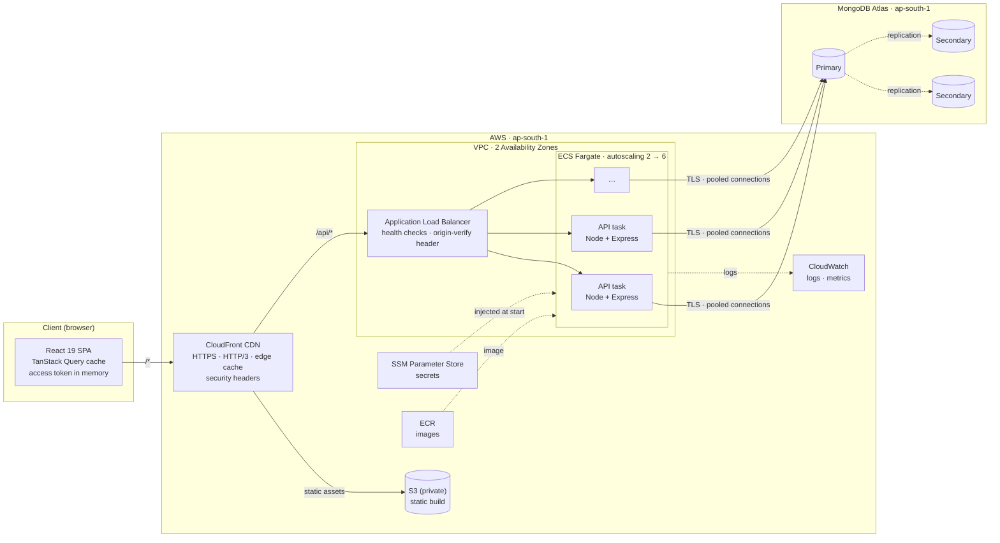
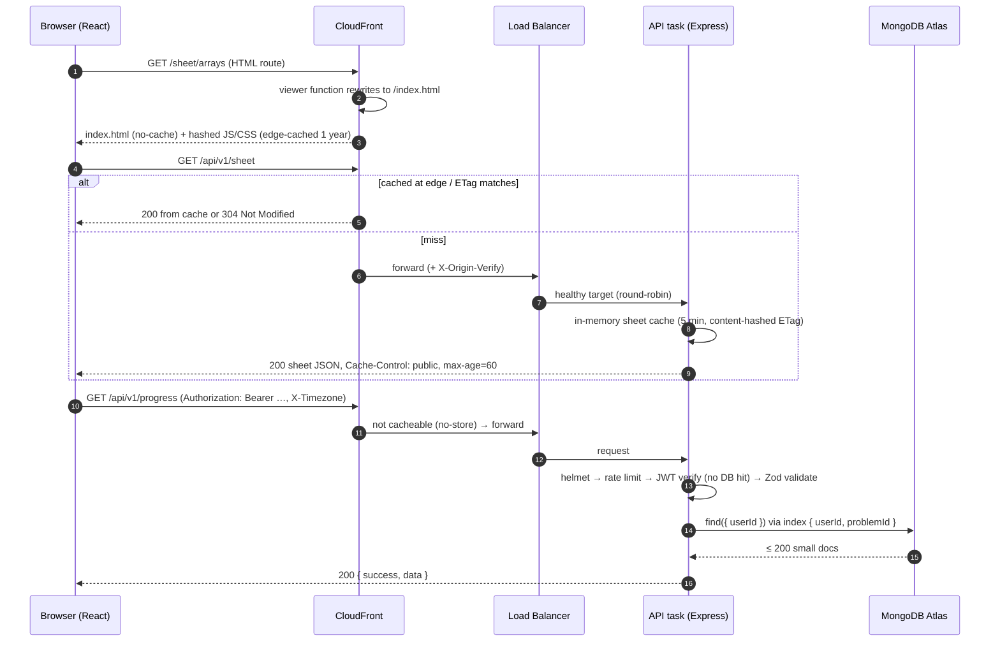

# System Design (HLD)

**Product:** DSA Sheet: a structured Data Structures & Algorithms sheet with persistent progress tracking, a personal study calendar and spaced-repetition revisions.
**Stack:** MongoDB · Express · React · Node.js, TypeScript end-to-end · **Cloud:** AWS — designed for ap-south-1 (Mumbai); live demo at https://dd2dekdh8uhzz.cloudfront.net (ap-southeast-2, [lite profile](./DEPLOYMENT.md#two-deployment-profiles))
**Design target:** 10,000–50,000 active students

> Companion documents: [Database Schema (LLD)](./DATABASE_SCHEMA.md) · [API Design](./API.md) · [Deployment](./DEPLOYMENT.md) · [Load-test results](../loadtest/RESULTS.md) · [Architecture Decision Records](./adr)

---

## 1. Requirements

**Functional (from the brief)**

| #   | Requirement                                                             | Where it lives                                                                                                                                  |
| --- | ----------------------------------------------------------------------- | ----------------------------------------------------------------------------------------------------------------------------------------------- |
| 1   | Secure login for students                                               | JWT access token + rotating httpOnly refresh cookie, bcrypt (§4)                                                                                |
| 2   | Chapters → Topics → Problems hierarchy                                  | `chapters`, `topics`, `problems` collections; `/sheet` and `/sheet/:chapter` pages                                                              |
| 3   | Each chapter broken into sub-topics / problems                          | 12 chapters · 39 topics · 200 problems                                                                                                          |
| 4   | YouTube + LeetCode/Codeforces + article for every topic **and** problem | `resources` sub-document on both; 717 links verified by an automated validator                                                                  |
| 5   | Easy / Medium / Hard on every problem **and** topic                     | `difficulty` on both, using the platforms' official ratings                                                                                     |
| 6   | Checkbox per problem; persisted; resume on next login                   | `PUT /progress/:problemId`, optimistic UI, `lastActive` + "Continue where you left off"                                                         |
| 7   | Standalone calendar to plan, track and revisit                          | `/calendar` page: month/week/agenda, drag and drop, auto-plan, done/missed/overdue states, rollover, spaced-repetition revisions, `.ics` export |

**Non-functional**

| Concern      | Target                                                                                                                       |
| ------------ | ---------------------------------------------------------------------------------------------------------------------------- |
| Scale        | 50k active students, ~5k concurrent at peak (exam / placement season, evenings IST)                                          |
| Latency      | p95 < 300 ms for reads, < 500 ms for writes (measured: **28 ms / 30 ms** at 500 concurrent students)                         |
| Availability | Multi-AZ, no single point of failure in the app tier, zero-downtime deploys                                                  |
| Durability   | A ticked checkbox is never lost: acknowledged only after the database write (majority write concern on Atlas)                |
| Security     | OWASP Top-10 aware: hashed passwords, no tokens in JS-readable storage, input validation, rate limiting, least-privilege IAM |

---

## 2. Architecture overview: Client → Server → Database → Deployment



| Tier           | Technology                                                                                            | Responsibility                                                                                                                          |
| -------------- | ----------------------------------------------------------------------------------------------------- | --------------------------------------------------------------------------------------------------------------------------------------- |
| **Client**     | React 19, Vite, TypeScript, Tailwind CSS v4, shadcn/ui (Radix), TanStack Query, Zustand, FullCalendar | UI, optimistic updates, client cache, routing, accessibility                                                                            |
| **Edge**       | CloudFront                                                                                            | TLS, compression, caching the SPA and the public sheet, a single origin for web + API (first-party, `SameSite=Strict` cookies; no CORS) |
| **Server**     | Node 22, Express 5, Zod, Mongoose, Pino                                                               | Stateless REST API: auth, validation, business rules (revisions, plan generation), aggregation                                          |
| **Database**   | MongoDB Atlas (3-node replica set)                                                                    | Durable storage; indexes for every query pattern                                                                                        |
| **Deployment** | Docker → ECR → ECS Fargate behind ALB; S3 + CloudFront; CloudFormation; GitHub Actions                | Repeatable, zero-downtime, auto-rollback deploys                                                                                        |

### Codebase structure

```
dsa-sheet/
├── shared/   Zod schemas + TypeScript types used by BOTH client and server (one source of truth)
├── server/   routes → controllers → services → models  (+ seed, link validator, tests)
├── client/   features/{auth,sheet,dashboard,calendar,revision,settings} + design-system components
├── infra/    Dockerfiles, nginx, AWS CloudFormation + deploy script
├── e2e/      Playwright end-to-end tests
├── loadtest/ k6 scenarios + results
└── docs/     this document, schema, API, deployment, ADRs
```

The server is **layered**. Routes declare validation and auth, controllers stay thin, services hold all business logic, and models define schema and indexes. Because `shared/` holds the validation schemas, the same rules run in the browser (instant form feedback) and on the server (the security boundary).

---

## 3. Request flow



Middleware pipeline on every API request, in order:

1. Request id + structured log (`pino-http`)
2. `helmet` security headers
3. `compression`
4. JSON body limit of 100 KB
5. Cookie parser
6. Timezone resolution (`X-Timezone`)
7. Per-IP rate limit
8. Route-level `requireAuth` (stateless JWT verify)
9. Zod validation
10. Controller → service → model
11. Central error handler, which produces the uniform error envelope

---

## 4. Authentication mechanism

**Short-lived access token + long-lived, rotating, server-side refresh session.**

| Token         | Format                            | Lifetime | Stored where                                                                                                         | Sent how                                |
| ------------- | --------------------------------- | -------- | -------------------------------------------------------------------------------------------------------------------- | --------------------------------------- |
| Access token  | JWT (HS256, `sub`, `role`, `iss`) | 15 min   | **JS memory only** (Zustand), never `localStorage`                                                                   | `Authorization: Bearer` header          |
| Refresh token | 384-bit random opaque string      | 7 days   | **httpOnly + Secure + SameSite=Strict cookie**, `Path=/api/v1/auth`; DB keeps only its **SHA-256 hash** (`sessions`) | Automatically, only to `/api/v1/auth/*` |

```mermaid
sequenceDiagram
    autonumber
    participant B as Browser
    participant API as API
    participant DB as MongoDB

    Note over B,API: Login
    B->>API: POST /auth/login { email, password }
    API->>DB: findOne({ email }) + bcrypt.compare (cost 12, constant-time even for unknown emails)
    API->>DB: insert session { userId, sha256(refresh), expiresAt }
    API-->>B: { user, accessToken } + Set-Cookie dsa_rt (httpOnly)

    Note over B,API: Normal requests (stateless, no DB lookup for auth)
    B->>API: GET /progress  Authorization: Bearer <access>
    API->>API: jwt.verify(signature, expiry, issuer)

    Note over B,API: Access token expired → silent refresh
    B->>API: GET /progress → 401 TOKEN_EXPIRED
    B->>API: POST /auth/refresh (cookie sent automatically; single-flight on the client)
    API->>DB: findOneAndDelete({ tokenHash }) (rotation, so the old token is consumed)
    API->>DB: insert new session
    API-->>B: new accessToken + new cookie
    B->>API: retry GET /progress ✓

    Note over B,API: Page reload → session restored from the cookie, nothing in localStorage
    Note over B,API: Logout → delete session row + clear cookie. "Log out everywhere" → delete all rows
```

**Why this design**

- **XSS-resistant:** the long-lived credential is never readable by JavaScript, and the access token lives only in memory and expires in 15 minutes.
- **CSRF-resistant:** the cookie is `SameSite=Strict`, is scoped to the auth path only, and is useless on its own; every data endpoint requires the Bearer header.
- **Revocable:** logout and "log out of all devices" work immediately, unlike pure-JWT schemes.
- **Replay-resistant:** refresh tokens are single-use (rotation), and a database leak exposes only hashes.
- **Scales horizontally:** verifying the access token needs no database or session store, so any API task can serve any request.
- **Hardening:**
  - Passwords need at least 8 characters including a letter and a digit, and are bcrypt-hashed at cost 12.
  - Login uses a generic error message and timing that doesn't reveal whether an email exists.
  - Login allows 10 **failed** attempts per 15 minutes per IP + email; successful logins never count, so students sharing a campus network can't lock each other out. Sign-up allows 10 accounts per hour per IP, and the demo login 60 per 15 minutes (it has no secret, but each login costs a bcrypt hash). A 429 response tells the user when they can try again.
  - The server refuses to start with a JWT secret shorter than 32 characters.

---

## 5. Data flow for progress tracking

The PDF's key requirement: _"Marking a problem complete should persist the progress. On next login, the student should resume exactly where they left off."_

```mermaid
sequenceDiagram
    autonumber
    participant U as Student
    participant UI as React (TanStack Query)
    participant API as API
    participant DB as MongoDB

    U->>UI: ticks ☑ "Two Sum"
    UI->>UI: optimistic update: checkbox, topic/chapter bars, sidebar % change instantly
    UI->>API: PUT /progress/:problemId { status: "solved" }
    API->>DB: upsert userProgress {userId, problemId} (unique index → idempotent)
    par side effects
        API->>DB: users.lastActive = { problemId, now }
        API->>DB: pending study tasks for this problem → done
        API->>DB: insert 4 revision events at +1, +3, +7, +21 days (user-local dates)
    end
    API-->>UI: 200 canonical row
    UI->>UI: reconcile cache; refetch stats / heatmap / calendar in the background
    alt request fails
        UI->>UI: roll back to the previous state + error toast
    end

    Note over U,DB: Next login (any device)
    U->>UI: logs in
    UI->>API: GET /progress, GET /progress/stats
    API->>DB: progress rows + lastActive
    API-->>UI: ticks restored + continue = last problem (or the next unsolved one after it)
    UI-->>U: "Continue where you left off: Two Sum → Resume" deep-links to the row and highlights it
```

**Guarantees**

- **Persisted before acknowledged:** the 200 is returned only after MongoDB accepts the write; on Atlas this is majority write concern across AZs.
- **Idempotent:** retries, double-clicks and flaky networks can never create duplicates (unique compound index + upsert).
- **Per-user isolation:** every query is scoped by the `userId` taken from the verified token, never from the request body.
- **Resume precision:** `lastActive` is updated both when a problem's status changes and when its video, practice or article link is opened. If that problem is already solved, the next unsolved problem in sheet order is suggested.
- **Calendar consistency:** ticking a problem completes its planned study task and schedules its revisions. Completing a study task on the calendar ticks the problem on the sheet. Both views share one source of truth.

---

## 6. Calendar design (PDF §7)

The calendar is a full page that supports three activities.

| Activity    | Feature                | Implementation                                                                                                                                                                                    |
| ----------- | ---------------------- | ------------------------------------------------------------------------------------------------------------------------------------------------------------------------------------------------- |
| **Plan**    | Auto study-plan wizard | Spreads unsolved problems, in sheet order (easy → hard within topics), over the chosen study days until the target date. A live capacity preview suggests the daily goal needed to finish on time |
|             | Drag-and-drop          | Drag a backlog problem onto a day or time slot to create a study task; drag existing tasks to reschedule                                                                                          |
|             | Manual entries         | Study / revision / contest / personal entries, all-day or timed, with notes                                                                                                                       |
| **Track**   | Status                 | `pending` / `done` / `missed`; overdue tasks are highlighted                                                                                                                                      |
|             | Rollover               | "Move overdue to today" keeps the originals as `missed`, so history stays honest                                                                                                                  |
|             | Weekly progress        | "5 of 55 tasks done this week", plus the dashboard's today agenda, streak and heatmap                                                                                                             |
| **Revisit** | Spaced repetition      | Solving a problem schedules revisions at +1 / +3 / +7 / +21 days; the Revision page shows the due queue and the next 14 days                                                                      |
|             | Export                 | `.ics` download for Google, Apple or Outlook Calendar                                                                                                                                             |

Dates are stored as **user-local `YYYY-MM-DD` keys** (the client sends `X-Timezone`). "Today", streaks and due revisions are therefore correct for a student in IST at 11:58 pm, and calendar range queries are simple indexed string comparisons.

---

## 7. Scalability: handling 10k–50k students

### 7.1 Capacity estimate

| Assumption                                  | Value                                                                  |
| ------------------------------------------- | ---------------------------------------------------------------------- |
| Active students                             | 50,000                                                                 |
| Peak concurrency (evening IST, exam season) | 10 % → **5,000** concurrent                                            |
| API requests per active student             | ~6 / min while studying (navigate, tick, open calendar) → 0.1 req/s    |
| Sheet payload                               | Served from CloudFront / browser cache; excluded from API load         |
| **Peak API load**                           | 5,000 × 0.1 ≈ **500 req/s** (with 2× safety headroom: **1,000 req/s**) |
| Write share                                 | ~30 % → ~150–300 writes/s, each a single indexed upsert                |

| Measured (see [load test](../loadtest/RESULTS.md)) | Result                                               |
| -------------------------------------------------- | ---------------------------------------------------- |
| 500 concurrent students, realistic think time      | p95 **28 ms**, 0 errors                              |
| One API process, constant 600 req/s                | median 2.3 ms, p95 105 ms, 0 errors                  |
| Saturation of one process                          | ~800–900 req/s, degrades by queueing, still 0 errors |

**Sizing:**

- **Peak:** 4 Fargate tasks (0.5 vCPU, assuming ~250–300 req/s each on smaller cores) cover peak with headroom.
- **Baseline:** autoscaling keeps 2 tasks running, across both AZs.
- **Burst:** the service scales out to 6 tasks on CPU above 60 %.
- **Database:** Atlas M10–M20 for 10k students, M30 for 50k (≈ 3–5 GB data plus indexes in RAM; see the [schema sizing](./DATABASE_SCHEMA.md#4-sizing-at-50000-active-students)).

### 7.2 What makes it scale

1. **Stateless API.** JWT verification needs no session store, so any task serves any request. Scaling is linear: add tasks behind the ALB.
2. **Cache the read-heavy, user-independent data.**
   - The sheet (~100 KB) is identical for every student. It is cached in API memory (content-hashed ETag), at CloudFront (`max-age=60, stale-while-revalidate`) and in browsers (`304`).
   - It is by far the largest response (~100 KB, about a third of all bytes in the realistic load test), so taking it off the API's hot path is the single biggest win.
3. **Every per-user query is an indexed point or range lookup.** The `userId`-prefixed compound indexes bound each query to that user's few hundred rows, so cost does not grow with the total number of users.
4. **Writes are tiny and contention-free.** One small document per (user, problem): no hot documents, no growing arrays, no transactions on the hot path.
5. **Connection pooling.** `maxPoolSize: 50` per task (6 tasks = 300 connections, well within Atlas M30 limits).
6. **Client-side efficiency.**
   - The TanStack Query cache, optimistic updates and background refetch avoid redundant calls.
   - FullCalendar (~280 KB) is lazy-loaded only on the calendar route.
   - Hashed assets are cached immutably for a year.
7. **Back-pressure and abuse protection.** Per-IP rate limits, a 100 KB body limit and validation reject bad input before it reaches the database.
8. **Graceful operations.**
   - Health checks drive ALB routing.
   - `SIGTERM` handling drains in-flight requests during deploys.
   - Keep-alive timeouts are tuned above the ALB idle timeout, which prevents 502s.
   - The ECS deployment circuit breaker auto-rolls back unhealthy releases.

### 7.3 Reliability

| Failure              | Effect                        | Mitigation                                                                                     |
| -------------------- | ----------------------------- | ---------------------------------------------------------------------------------------------- |
| One API task crashes | None visible                  | ALB health checks remove it; ECS replaces it                                                   |
| One AZ goes down     | Reduced capacity              | Tasks run in 2 AZs; Atlas replica set spans 3 AZs with automatic failover (~seconds)           |
| Bad deploy           | None                          | Rolling deploy with min 100 % healthy; circuit breaker rolls back                              |
| DB primary failover  | A few seconds of write errors | MongoDB driver retryable writes; the client rolls back optimistic state and the user can retry |
| Dead content link    | Broken resource for students  | Weekly CI link validator (oEmbed / LeetCode GraphQL / Codeforces API / HTTP)                   |

### 7.4 Observability

- **Logs:** structured JSON (Pino) with a request id, also returned in the `X-Request-Id` header. Authorization headers and cookies are **redacted**. Logs ship to CloudWatch.
- **Metrics:** ECS Container Insights (CPU, memory, task count), ALB target response time and 5xx rate, Atlas metrics.
- **Health:** `GET /api/v1/health` checks database connectivity (503 when it is down).

---

## 8. Security summary

| Threat                            | Control                                                                                                    |
| --------------------------------- | ---------------------------------------------------------------------------------------------------------- |
| Credential stuffing / brute force | Failed-attempt limit per IP + email, bcrypt cost 12, generic errors with constant timing                   |
| XSS token theft                   | Refresh token in an httpOnly cookie; access token in memory, 15 min; strict CSP via helmet; React escaping |
| CSRF                              | `SameSite=Strict` path-scoped cookie; data APIs require the Bearer header                                  |
| Injection / malformed input       | Zod validation on every input; Mongoose strict schemas and `strictQuery`; ObjectId validation              |
| Broken access control             | Every query scoped by the token's `userId`; other users' resources return 404                              |
| Secrets exposure                  | SSM SecureString injected at runtime; `.env` git-ignored; env validated at boot                            |
| Direct origin access              | ALB accepts only CloudFront IP ranges carrying the secret origin header; S3 is private (OAC)               |
| Transport                         | HTTPS everywhere (CloudFront redirect + HSTS); TLS to Atlas                                                |

---

## 9. Trade-offs (bonus)

| Decision                  | Chosen                                            | Alternative                                | Reasoning                                                                                                                                                                                                             |
| ------------------------- | ------------------------------------------------- | ------------------------------------------ | --------------------------------------------------------------------------------------------------------------------------------------------------------------------------------------------------------------------- |
| Database                  | **MongoDB**                                       | PostgreSQL                                 | The content is naturally hierarchical documents (topic → resources), progress is a simple keyed upsert, and the brief asks for MERN. Postgres would also work; there are no multi-entity transactions on the hot path |
| Progress model            | **One doc per (user, problem)**                   | Array inside the user document             | Avoids unbounded documents and write contention; indexed and idempotent ([ADR-002](./adr/002-progress-as-separate-collection.md))                                                                                     |
| Auth                      | **JWT access + rotating refresh cookie**          | Server sessions only / JWT in localStorage | Stateless scaling _and_ revocation _and_ XSS safety ([ADR-003](./adr/003-auth-tokens.md))                                                                                                                             |
| Stats                     | **Computed on read**                              | Counters maintained on write               | Always consistent, simpler; ~1 ms per user at this size. Revisit only if profiling demands it                                                                                                                         |
| Topology                  | **Single origin via CloudFront** (`/api/*` → ALB) | Separate API domain + CORS                 | First-party cookies, no CORS preflights, one TLS certificate ([ADR-004](./adr/004-single-origin-cloudfront.md))                                                                                                       |
| Compute                   | **ECS Fargate**                                   | EC2 + PM2 / Lambda                         | No servers to patch, autoscaling and rolling deploys built in. Lambda cold starts and connection pooling to MongoDB are awkward                                                                                       |
| Calendar dates            | **User-local `YYYY-MM-DD` strings**               | UTC timestamps                             | Correct "today" for every timezone; trivial range queries ([ADR-005](./adr/005-local-date-keys.md))                                                                                                                   |
| Monorepo + shared package | **npm workspaces**                                | Separate repos                             | One PR changes API + UI + types atomically; validation rules can't diverge                                                                                                                                            |
| Content links             | **Fetched and verified from the platforms**       | Hand-typed URLs                            | Official titles and difficulty; no dead or mismatched videos; re-validated weekly in CI                                                                                                                               |

## 10. Future scalability improvements (bonus)

1. **Redis (ElastiCache)** for the shared rate-limit store and the sheet cache, plus a pub/sub cache-invalidation signal when admins edit content.
2. **Read replicas** (`readPreference: secondaryPreferred`) for dashboard/heatmap aggregations if reads dominate.
3. **Sharding** `userProgress` and `calendarEvents` on hashed `userId` beyond a few hundred million rows. Every per-user query already includes `userId`, so it would target a single shard.
4. **Event-driven side effects:** move revision scheduling and analytics to a queue (SQS) so the write path is a single upsert.
5. **WAF + bot control** on CloudFront; private networking to Atlas (PrivateLink, NAT fixed egress).
6. **Precomputed leaderboards / cohort analytics** in a separate analytical store if product needs grow.
7. **PWA offline mode:** queue ticks offline and sync on reconnect (the idempotent PUT makes replay safe).
